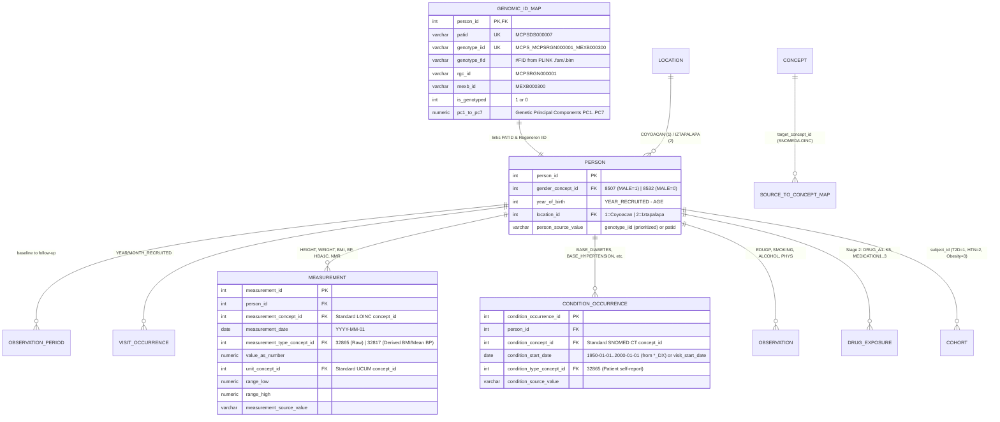
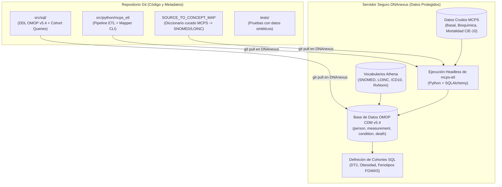

# Protocolo Técnico: Estandarización de MCPS hacia OMOP CDM v5.4 en DNAnexus

## 1. Justificación del Cambio de Alcance (De DGIS/ENSANUT a MCPS)

> [!IMPORTANT]
> **Decisión de Arquitectura (Noviembre 2026):** Se reestructura el proyecto para descartar el uso de bases abiertas intermedias (**DGIS — Egresos Hospitalarios** o **ENSANUT**) y construir el pipeline ETL **directamente sobre el Mexico City Prospective Study (MCPS)**.

### ¿Por qué descartar DGIS o ENSANUT en este proyecto?

1. **Escala y complejidad desproporcionadas:** Tanto los registros nacionales de **Egresos Hospitalarios de la DGIS** como las rondas de la **ENSANUT** constituyen bases de datos masivas, heterogéneas y orientadas a fines administrativos o encuestas poblacionales multipropósito. Armonizar la totalidad de sus catálogos (miles de códigos CIE-10, procedimientos CIE-9-MC, causas externas y cuestionarios cambiantes por año) representa un **proyecto independiente mucho más amplio** que excede los objetivos de este trabajo.
2. **Curva de aprendizaje sobre una base ajena vs. dominio directo de MCPS:** Invertir el tiempo del proyecto en descifrar las particularidades administrativas de una base externa desconocida desvía el esfuerzo del objetivo científico real. En cambio, el autor ya trabaja directamente con **MCPS**, conoce a fondo su estructura y variables, y cuenta con acceso autorizado a los datos.
3. **Alineación directa con el objetivo científico ("Conectar MCPS a OMOP/SNOMED"):** El propósito central dentro de la investigación doctoral es estandarizar los fenotipos metabólicos y antropométricos de MCPS en **OMOP CDM v5.4** (usando **SNOMED CT** y **LOINC**) para habilitar meta-análisis de GWAS basados en familias (*FGWAS*) comparables con cohortes internacionales (p. ej., UK Biobank). Trabajar directamente sobre MCPS resuelve el problema real desde el primer día.

---

## 2. Entorno de Ejecución y Gobernanza de Datos Protegidos (DNAnexus)

> [!CAUTION]
> **Datos Protegidos — Regla de Cero Fuga de Datos:** Los datos de **MCPS** contienen información clínica, demográfica y genómica a nivel individual protegida bajo acuerdos de acceso (*Data Access Agreement*). **Ningún dato individual, extracto crudo ni base de datos poblada puede salir de DNAnexus ni subirse a Git.**

### Implicaciones operativas de trabajar en un servidor de DNAnexus

1. **Procesamiento 100% remoto:** Toda la exploración de datos, transformación ETL, carga en base de datos y ejecución de consultas SQL de cohortes se realiza dentro de un servidor/instancia de **DNAnexus** (entorno Linux remoto accedido por terminal SSH / CLI `dx-toolkit` o JupyterLab).
2. **Separación estricta entre código y datos:**
   - **En este repositorio Git:** Únicamente viven el código fuente (`src/python/mcps_etl`), los esquemas DDL y consultas SQL (`src/sql/`), las tablas de mapeo semántico sin datos de pacientes (`SOURCE_TO_CONCEPT_MAP`), la documentación (`docs/`) y pruebas unitarias con **datos sintéticos** (`tests/`).
   - **En el servidor DNAnexus:** Residen los archivos planos crudos de MCPS (CSV/Parquet), los archivos del vocabulario descargados de Athena y la instancia de base de datos con el modelo OMOP CDM v5.4 poblado.
3. **Ausencia de interfaz gráfica (Sin GUI para `Usagi` o `WhiteRabbit`):**
   - Al trabajar dentro de un servidor Linux remoto en DNAnexus sin entorno de escritorio gráfico, **no es posible ejecutar aplicaciones interactivas de escritorio (Java Swing/GUI) como `Usagi` o `WhiteRabbit`** directamente sobre el servidor.
   - Todo el flujo de perfilado y mapeo de códigos fuente hacia conceptos estándar de OMOP/SNOMED/LOINC debe ejecutarse mediante **herramientas de línea de comandos (CLI), scripts en Python y consultas SQL** (ver Sección 4).

---

## 3. Especificación del Modelo OMOP CDM v5.4 para MCPS y Vinculación de IDs Genómicos

Referencia oficial: [The Book of OHDSI — Chapter 4: The Common Data Model](https://ohdsi.github.io/TheBookOfOhdsi/CommonDataModel.html)


### Diagrama Entidad-Relación (`erDiagram`) de la Base de Datos MCPS / OMOP CDM v5.4

Dado que los archivos clínicos crudos (`mcps_baseline-full.csv`, $N = 159,517$) utilizan el identificador fenotípico `PATID` (`MCPSDSxxxxxx`), mientras que todos los archivos genéticos de Regeneron (`.fam`/`.bim`/`.keep` y `complete-set.qc-phenotypes.txt`, $N = 139,880$) utilizan el identificador genotípico `IID` / `FID` (`MCPS_MCPSRGNxxxxxx_MEXBxxxxxx`), el esquema incluye la tabla puente **`genomic_id_map`** vinculada 1:1 con `person(person_id)`:



### Naturaleza de los datos de MCPS y su ajuste a OMOP CDM

**MCPS** reclutó a ~150,000 adultos ($\ge 35$ años; ~140,000 con genotipado) en Coyoacán e Iztapalapa (Ciudad de México) entre **1998 y 2004**, con una encuesta de re-evaluación (*resurvey*) en ~10,000 participantes (2015–2019) y seguimiento longitudinal continuo mediante vinculación con el registro nacional de mortalidad codificado en **CIE-10**.

| Tabla destino en OMOP CDM | Fuente en MCPS                                        | Variables clave de MCPS                                                                                                                                                             | Vocabulario estándar destino                                                                                                                    |
| ------------------------- | ----------------------------------------------------- | ----------------------------------------------------------------------------------------------------------------------------------------------------------------------------------- | ------------------------------------------------------------------------------------------------------------------------------------------------ |
| `person`                | Tabla demográfica basal                              | `PATID` (ID participante), `MALE`/`SEX`, `AGE`, fecha de reclutamiento (`1998–2004`), distrito (`COYOACAN`/`IZTAPALAPA`)                                             | `Gender` (`8507` Male, `8532` Female), `Race` / `Ethnicity`                                                                            |
| `observation_period`    | Fechas de seguimiento                                 | Inicio: fecha de visita basal (`BASE_DATE`). Fin: fecha de defunción o fecha de corte de seguimiento                                                                             | `Period Type` (`32880` Standardized health system data / cohort study)                                                                       |
| `visit_occurrence`      | Evaluación basal y *resurvey*                      | Visita de reclutamiento basal (1998–2004) y visita de re-contacto (si aplica)                                                                                                      | `Visit` (Outpatient / Study visit)                                                                                                             |
| `measurement`           | Antropometría, presión arterial y bioquímica / RMN | `BMI` (IMC), `HEIGHT` (estatura), `WEIGHT` (peso), `WAIST` (cintura), `HIP` (cadera), `SBP1..3` (PAS), `DBP1..3` (PAD), `HBA1C`, glucosa, lípidos, metabolitos RMN | **LOINC** / **SNOMED** (`domain_id = 'Measurement'`) + **UCUM** para unidades (`kg/m2`, `cm`, `kg`, `mm[Hg]`, `%`) |
| `condition_occurrence`  | Cuestionario clínico basal y episodios vinculados    | Diagnósticos previos autorreportados en visita basal (diabetes, hipertensión, infarto, EVC, ERC, cáncer) y condiciones CIE-10                                                    | **SNOMED CT** (`domain_id = 'Condition'`)                                                                                                |
| `death`                 | Seguimiento de mortalidad vinculada                   | Fecha de defunción (`DOD`), causa básica de muerte y causas contribuyentes codificadas en **CIE-10**                                                                      | **SNOMED CT** (vía mapeo `ICD10` → `SNOMED` en Athena)                                                                               |
| `drug_exposure`         | Medicación basal autorreportada                      | Uso de hipoglucemiantes orales, insulina, antihipertensivos, estatinas/hipolipemiantes                                                                                              | **RxNorm** / **ATC**                                                                                                                 |
| `observation`           | Estilo de vida y socioeconómicos                     | Tabaquismo, consumo de alcohol, actividad física, escolaridad, ingreso                                                                                                             | **SNOMED CT** / **LOINC** (`domain_id = 'Observation'`)                                                                            |

---

## 4. Estrategia de Mapeo Semántico sin GUI (Reemplazo Headless de `Usagi` en DNAnexus)

Dado que en el servidor de DNAnexus no contamos con GUI para abrir `Usagi`, el mapeo hacia `SOURCE_TO_CONCEPT_MAP` se divide en **tres vías complementarias** operables 100% desde terminal/Python/SQL:

### Vía 1 — Mapeo automático por Crosswalk Oficial de Athena (Códigos CIE-10)

Los registros de mortalidad vinculada de MCPS ya están codificados en **CIE-10 (ICD-10)**. Para estos códigos **no se requiere Usagi**: el vocabulario oficial de Athena ya incluye las relaciones validadas `ICD10` → `SNOMED`.

El cruce se realiza directamente en SQL o Python usando las tablas `CONCEPT` y `CONCEPT_RELATIONSHIP`:

```sql
SELECT
    c_src.concept_code       AS icd10_source_code,
    c_src.concept_id         AS source_concept_id,
    c_src.concept_name       AS icd10_name,
    c_tar.concept_id         AS target_concept_id,
    c_tar.concept_name       AS snomed_standard_name,
    c_tar.domain_id          AS target_domain_id
FROM concept c_src
JOIN concept_relationship cr
  ON c_src.concept_id = cr.concept_id_1
 AND cr.relationship_id = 'Maps to'
 AND cr.invalid_reason IS NULL
JOIN concept c_tar
  ON cr.concept_id_2 = c_tar.concept_id
 AND c_tar.standard_concept = 'S'
 AND c_tar.invalid_reason IS NULL
WHERE c_src.vocabulary_id IN ('ICD10', 'ICD10CM');
```

### Vía 2 — Diccionario Curado para Fenotipos Prioritarios (`SOURCE_TO_CONCEPT_MAP`)

A diferencia de una base abierta con miles de códigos desconocidos, las variables basales de MCPS provienen de un **cuestionario estructurado y cerrado**. Para los fenotipos cardiometabólicos y antropométricos núcleo del proyecto, se construye y versiona en Git una tabla CSV (`SOURCE_TO_CONCEPT_MAP`) con mapeo directo a conceptos estándar de **LOINC** y **SNOMED CT**:

| Variable MCPS (`source_code`) | Descripción                                        | Dominio OMOP    | Vocabulario estándar | `target_concept_id`      | Concepto estándar (`concept_name`)        | Unidad (`unit_concept_id` / UCUM) |
| ------------------------------- | --------------------------------------------------- | --------------- | --------------------- | -------------------------- | -------------------------------------------- | ----------------------------------- |
| `BMI`                         | Índice de masa corporal ($\text{kg/m}^2$)        | `Measurement` | LOINC                 | `3038553`                | Body mass index (BMI) [Ratio]                | `9531` (`kg/m2`)                |
| `HEIGHT`                      | Estatura de pie ($\text{cm}$)                     | `Measurement` | LOINC                 | `3036277`                | Body height                                  | `8582` (`cm`)                   |
| `WEIGHT`                      | Peso corporal ($\text{kg}$)                       | `Measurement` | LOINC                 | `3025315`                | Body weight                                  | `9529` (`kg`)                   |
| `WAIST_CIRC`                  | Circunferencia de cintura ($\text{cm}$)           | `Measurement` | LOINC                 | `40759207` / `4172830` | Waist circumference                          | `8582` (`cm`)                   |
| `SBP`                         | Presión arterial sistólica ($\text{mmHg}$)      | `Measurement` | LOINC                 | `3004249`                | Systolic blood pressure                      | `8876` (`mm[Hg]`)               |
| `DBP`                         | Presión arterial diastólica ($\text{mmHg}$)     | `Measurement` | LOINC                 | `3012888`                | Diastolic blood pressure                     | `8876` (`mm[Hg]`)               |
| `HBA1C`                       | Hemoglobina glucosilada HbA1c ($\%$)              | `Measurement` | LOINC                 | `3004410`                | Hemoglobin A1c/Hemoglobin.total in Blood     | `8554` (`%`)                    |
| `BASE_DIABETES`               | Diagnóstico previo de diabetes (autorreporte)      | `Condition`   | SNOMED                | `201826` / `201820`    | Type 2 diabetes mellitus / Diabetes mellitus | N/A                                 |
| `BASE_HYPERTENSION`           | Diagnóstico previo de hipertensión (autorreporte) | `Condition`   | SNOMED                | `316866`                 | Hypertensive disorder                        | N/A                                 |

### Vía 3 — Mapeo Programático en CLI (Equivalente Headless a `Usagi`)

Cuando se requiera mapear un lote amplio de variables adicionales del cuestionario o metabolitos de RMN sin acceso a GUI:

1. **En el servidor DNAnexus (Python CLI):**
   - Se extraen únicamente los metadatos del diccionario de variables (`source_code`, `source_description_en`, `domain_id`).
   - Un script de Python (`src/python/mcps_etl/`) utiliza similitud de texto (`rapidfuzz` o `pg_trgm` / `tsvector` dentro de PostgreSQL) contra las tablas `CONCEPT` y `CONCEPT_SYNONYM` de Athena (filtrando `standard_concept = 'S'` y el `domain_id` correspondiente).
   - El script exporta un archivo CSV con los $k$ mejores candidatos y su *similarity score*, replicando el índice de Lucene de Usagi pero desde terminal.
   - La revisión y aprobación (`status = 'APPROVED'`) se realiza editando el CSV (en terminal, JupyterLab o mediante PR en Git) y se exporta al esquema exacto de `SOURCE_TO_CONCEPT_MAP`.
2. **Alternativa híbrida sobre metadatos públicos (0% datos de pacientes):**
   - Dado que el **diccionario de variables de MCPS** (nombres de columnas y etiquetas de preguntas, sin filas de participantes) es metadato público (documentado en el *MCPS Data Showcase*), si en algún momento se desea usar la interfaz de `Usagi` en una computadora local, puede ejecutarse **exclusivamente sobre el catálogo vacío de nombres de variables** y subir el archivo `source_to_concept_map.csv` resultante al repositorio / servidor DNAnexus.

---

## 5. Flujo de Trabajo Completo en DNAnexus



---

## 6. Pasos de Implementación

1. **Fase 1 — Infraestructura y Esquema OMOP CDM v5.4:**
   - Configurar scripts SQL del DDL de OMOP CDM v5.4 y carga de vocabularios de Athena (`SNOMED`, `LOINC`, `ICD10`, `UCUM`, `RxNorm`).
   - Preparar generador de **datos sintéticos** con la misma estructura de columnas de MCPS para ejecutar pruebas locales y en GitHub Actions sin tocar datos reales.
2. **Fase 2 — Mapeo Semántico Headless (`SOURCE_TO_CONCEPT_MAP`):**
   - Consolidar el archivo `source_to_concept_map.csv` para las variables basales de MCPS (antropometría, presión arterial, HbA1c, comorbilidades basales) hacia **LOINC** y **SNOMED CT**.
   - Implementar la consulta/módulo de cruce automático `ICD10` → `SNOMED` usando `CONCEPT_RELATIONSHIP` para las causas de defunción.
3. **Fase 3 — Desarrollo del ETL (`src/python/mcps_etl`):**
   - Transformación de tabla basal a `person`, `observation_period` y `visit_occurrence`.
   - Transformación en formato largo (*melt/unpivot*) de mediciones cuantitativas (`BMI`, `HEIGHT`, `WEIGHT`, `SBP`, `DBP`, `HBA1C`) hacia `measurement`.
   - Transformación de diagnósticos basales y mortalidad vinculada hacia `condition_occurrence` y `death`.
4. **Fase 4 — Cohortes SQL y Validación de Calidad:**
   - Escribir consultas SQL reproducibles para definir cohortes clínicas (ej. Diabetes Tipo 2 y Obesidad) con tabla de atrición (*attrition table*).
   - Ejecutar validaciones automatizadas de integridad referencial y cobertura de mapeo en el servidor de DNAnexus.
