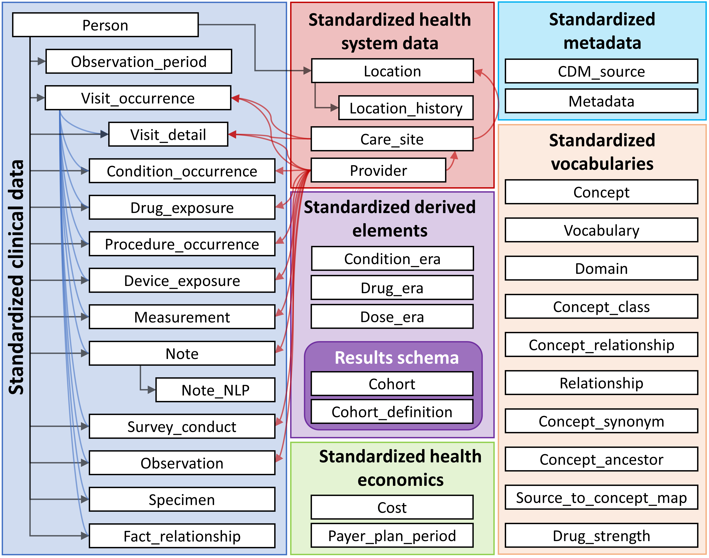
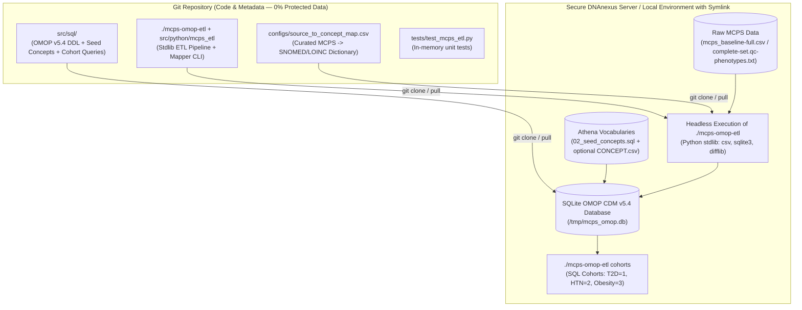

# Technical Protocol: Standardizing MCPS into OMOP CDM v5.4 on DNAnexus

## 1. Scope Adjustment & Architectural Pivot (From DGIS/ENSANUT to MCPS)

> [!IMPORTANT]
> **Architectural Decision (November 2026):** The project scope was restructured to discard intermediate open datasets (**DGIS — Hospital Discharges** or **ENSANUT**) and build the ETL pipeline **directly on the Mexico City Prospective Study (MCPS)**.

### Why pivot away from DGIS or ENSANUT?

1. **Disproportionate scale and scope mismatch:** Both the national **DGIS Hospital Discharges** database and the multi-wave **ENSANUT** health surveys are massive, general-purpose administrative or population-survey repositories. Harmonizing their full catalogs (thousands of ICD-10 and ICD-9-CM procedure codes, external causes, and questionnaires that change structure across survey waves) constitutes a separate, institutional-scale effort far beyond the scope of this project.
2. **Learning curve on an unfamiliar database vs. direct domain mastery of MCPS:** Spending weeks reverse-engineering administrative coding quirks in an external dataset diverts effort from the core scientific goal. Conversely, the author works directly with **MCPS**, is thoroughly familiar with its data dictionary and variables, and holds authorized access to the cohort.
3. **Direct alignment with the scientific goal ("Connecting MCPS to OMOP/SNOMED"):** The central objective within the doctoral research is to standardize MCPS metabolic and anthropometric phenotypes into **OMOP CDM v5.4** (using **SNOMED CT** and **LOINC**) to enable cross-cohort Family-Based GWAS (*FGWAS*) meta-analyses comparable with international biobanks (e.g., UK Biobank). Building directly on MCPS solves the real research problem from day one.

---

## 2. Execution Environment & Protected Data Governance (DNAnexus)

> [!CAUTION]
> **Protected Data — Zero Data Leakage Rule:** **MCPS** contains sensitive, individual-level clinical, demographic, and genomic data governed by strict Data Access Agreements (DAA). **No individual-level record, raw extract, PLINK file, or populated database (`*.db`) may ever leave authorized storage or be committed to Git.**

### Operational Implications of Working on a DNAnexus Server

1. **Self-Contained Remote Processing:** Data inspection, ETL transformation, database loading, and SQL cohort generation are designed to execute inside a **DNAnexus** cloud server/workstation (headless Linux environment accessed via SSH, `dx-toolkit` CLI, `ttyd`, or JupyterLab).
2. **Strict Separation Between Code and Data:**
   - **In this Git repository:** Only source code (`./mcps-omop-etl`, `src/python/mcps_etl`), DDL schemas and SQL queries (`src/sql/`), non-sensitive semantic mapping tables (`configs/source_to_concept_map.csv`), documentation (`docs/`), and unit tests using **in-memory fixtures** (`tests/test_mcps_etl.py`) are tracked.
   - **On the DNAnexus server (or untracked local `./data` symlink during development):** Reside the raw MCPS flat files (CSV/TSV), full Athena vocabulary dumps, and the populated SQLite OMOP CDM v5.4 database (`/tmp/mcps_omop.db`).
3. **Headless Execution (No GUI for `Usagi` or `WhiteRabbit`):**
   - Because remote Linux workers on DNAnexus lack a graphical desktop environment, **interactive desktop GUI applications (Java Swing) such as `Usagi` or `WhiteRabbit` cannot be run on the server**.
   - All profiling, concept verification, and source-to-standard vocabulary mapping are executed through **command-line tools (CLI), Python standard-library scripts, and SQL queries** (see Section 4).

---

## 3. OMOP CDM v5.4 Specification for MCPS & Genomic ID Linkage

Official reference: [The Book of OHDSI — Chapter 4: The Common Data Model](https://ohdsi.github.io/TheBookOfOhdsi/CommonDataModel.html)



### Entity-Relationship Diagram (`erDiagram`) of the MCPS / OMOP CDM v5.4 Database

Because raw clinical baseline files (`mcps_baseline-full.csv`, $N = 159,517$) use the phenotypic identifier `PATID` (`MCPSDSxxxxxx`), whereas all Regeneron genetic files (`.fam`/`.bim`/`.keep` and `complete-set.qc-phenotypes.txt`, $N = 139,880$) use the genotypic identifier `IID` / `FID` (`MCPS_MCPSRGNxxxxxx_MEXBxxxxxx`), the schema includes the **`genomic_id_map`** bridge table linked 1:1 with `person(person_id)`:


### Nature of MCPS Data and Alignment with OMOP CDM

**MCPS** recruited ~150,000 adults ($\ge 35$ years old; ~140,000 genotyped) across Coyoacán and Iztapalapa (Mexico City) between **1998 and 2004**, with a resurvey in ~10,000 participants (2015–2019) and continuous longitudinal follow-up via linkage to national **ICD-10** mortality registries.

| Target OMOP CDM Table | MCPS Data Source | Key MCPS Variables | Target Standard Vocabulary |
| :--- | :--- | :--- | :--- |
| `person` | Baseline demographic table | `PATID`, `IID`/`FID`, `MALE`, `AGE`, recruitment year/month (`1998–2004`), district (`COYOACAN`) | `Gender` (`8507` Male, `8532` Female), `Ethnicity` (`38003563` Hispanic or Latino) |
| `genomic_id_map` | Clinical-to-Genomic ID linkage | `PATID` (`MCPSDS*`), Regeneron `IID`/`FID` (`MCPS_MCPSRGN*_MEXB*`), `PC1..PC7` | Extension table linked 1:1 with `person(person_id)` |
| `observation_period` | Follow-up dates | Start: baseline recruitment visit (`YYYY-MM-01`). End: baseline or follow-up cutoff | `Period Type` (`32880` Standardized health system data) |
| `visit_occurrence` | Baseline & resurvey assessment | Baseline recruitment visit (`1998–2004`, `YYYY-MM-01`) | `Visit` (`9202` Outpatient Visit) |
| `measurement` | Anthropometry, blood pressure, biochemistry & NMR | `HEIGHT`, `WEIGHT`, `BMI` (`11_11_01`), `WAISTC`, `HIPC`, `WHRATIO`, `SBP1..3` (`11_01_01`), `DBP1..3` (`11_02_01`), `BASE_HBA1C` (`13_01_01`), NMR lipids/creatinine (`15_*`) | **LOINC** (`domain_id = 'Measurement'`) + **UCUM** units (`cm`, `kg`, `kg/m2`, `mm[Hg]`, `%`, `mmol/L`, `g/L`, `umol/L`) |
| `condition_occurrence` | Baseline clinical history & GWAS disease definitions | Self-reported baseline diagnoses (`BASE_DIABETES`, `BASE_HYPERTENSION`, `BASE_HEARTATTACK`, `BASE_ANGINA`, `BASE_STROKE`, `BASE_CKD`, `BASE_PAD`, `BASE_CIRR`) with diagnosis decade (`BASE_*_DX`) and GWAS definitions (`17_01_01..17_03_01`) | **SNOMED CT** (`domain_id = 'Condition'`) |
| `observation` | Socioeconomic & lifestyle covariates | `MARITAL_STATUS`, `EDUGP` (1–14), `OCCUPATION` (1–21), `INCOME`, `HEALTH_PROVIDER` (1–10), smoking, alcohol, physical activity, `FASTING_DURATION` | **SNOMED CT** / **LOINC** (`domain_id = 'Observation'`) |
| `death` / `drug_exposure` | Stage 2 extensions | Linked ICD-10 cause-specific mortality (`DOD`, `ICD10`) and baseline medications (`DRUG_A1..K5`) | **SNOMED CT** (via `ICD10` → `SNOMED` Athena crosswalk) & **RxNorm** / **ATC** |

---

## 4. Headless Semantic Mapping Strategy (GUI-Free `Usagi` Replacement on DNAnexus)

Because DNAnexus workstations do not provide a GUI to run `Usagi`, mapping source variables into `SOURCE_TO_CONCEPT_MAP` is implemented via **three complementary headless mechanisms** operable 100% from the terminal, Python, and SQL:

### Path 1 — Automated Official Athena Crosswalk (ICD-10 Mortality Codes)

Linked mortality records in MCPS are already coded in **ICD-10**. These codes **do not require Usagi**: the official Athena vocabulary includes validated `ICD10` → `SNOMED` relationships in `CONCEPT` and `CONCEPT_RELATIONSHIP`:

```sql
SELECT
    c_src.concept_code       AS icd10_source_code,
    c_src.concept_id         AS source_concept_id,
    c_src.concept_name       AS icd10_name,
    c_tar.concept_id         AS target_concept_id,
    c_tar.concept_name       AS snomed_standard_name,
    c_tar.domain_id          AS target_domain_id
FROM concept c_src
JOIN concept_relationship cr
  ON c_src.concept_id = cr.concept_id_1
 AND cr.relationship_id = 'Maps to'
 AND cr.invalid_reason IS NULL
JOIN concept c_tar
  ON cr.concept_id_2 = c_tar.concept_id
 AND c_tar.standard_concept = 'S'
 AND c_tar.invalid_reason IS NULL
WHERE c_src.vocabulary_id IN ('ICD10', 'ICD10CM');
```

### Path 2 — Curated Dual-Code Dictionary for Priority Phenotypes (`configs/source_to_concept_map.csv`)

Unlike an open administrative database with thousands of unstructured codes, MCPS baseline variables come from a **closed, structured cohort dictionary** (`MCPS_BASELINE` v1.1, April 2025 update) and the **MCPS Regeneron GWAS Phenotype Catalogue** (`MCPS_GWAS_CATALOG`). We version-control a curated lookup table in `configs/source_to_concept_map.csv` recording **both** the native terminology code (`target_concept_code` in LOINC / SNOMED CT) and the integer Athena `target_concept_id`:

| MCPS `source_code` | Source Vocabulary | Description | OMOP Domain | Standard Vocabulary | `target_concept_code` | `target_concept_id` | UCUM Unit (`unit_concept_id`) |
| :--- | :--- | :--- | :--- | :--- | :--- | :--- | :--- |
| `HEIGHT` / `11_07_01` | `MCPS_BASELINE` / `GWAS` | Standing height ($\text{cm}$) | `Measurement` | LOINC | `8302-2` | `3036277` | `8582` (`cm`) |
| `WEIGHT` | `MCPS_BASELINE` | Body weight ($\text{kg}$) | `Measurement` | LOINC | `29463-7` | `3025315` | `9529` (`kg`) |
| `BMI` / `11_11_01` | `MCPS_BASELINE` / `GWAS` | Body mass index ($\text{kg/m}^2$) | `Measurement` | LOINC | `39156-5` | `3038553` | `9531` (`kg/m2`) |
| `WAISTC` | `MCPS_BASELINE` | Waist circumference ($\text{cm}$) | `Measurement` | LOINC | `8280-0` | `40759207` | `8582` (`cm`) |
| `SBP_MEAN` / `11_01_01` | `MCPS_BASELINE` / `GWAS` | Systolic blood pressure ($\text{mmHg}$) | `Measurement` | LOINC | `8480-6` | `3004249` | `8876` (`mm[Hg]`) |
| `DBP_MEAN` / `11_02_01` | `MCPS_BASELINE` / `GWAS` | Diastolic blood pressure ($\text{mmHg}$) | `Measurement` | LOINC | `8462-4` | `3012888` | `8876` (`mm[Hg]`) |
| `BASE_HBA1C` / `13_01_01` | `MCPS_BASELINE` / `GWAS` | Glycated HbA1c ($\%$ DCCT) | `Measurement` | LOINC | `4548-4` | `3004410` | `8554` (`%`) |
| `BASE_DIABETES` / `17_01_01` | `MCPS_BASELINE` / `GWAS` | Diabetes mellitus | `Condition` | SNOMED | `73211009` | `201820` | N/A |
| `17_03_01` | `MCPS_GWAS_CATALOG` | Type 2 diabetes mellitus (QC filtered) | `Condition` | SNOMED | `44054006` | `201826` | N/A |
| `BASE_HYPERTENSION` / `17_02_01` | `MCPS_BASELINE` / `GWAS` | Hypertensive disorder | `Condition` | SNOMED | `38341003` | `316866` | N/A |

### Path 3 — Programmatic CLI Verification & Candidate Generation (`verify-concepts` & `suggest-mappings`)

In `src/python/mcps_etl/mapper.py`, two headless CLI utilities replace Usagi's interactive workflow:
1. **`./mcps-omop-etl verify-concepts --athena-concept CONCEPT.csv`:** Cross-checks every row in `configs/source_to_concept_map.csv` against an official Athena `CONCEPT.csv` table, confirming that `(target_vocabulary_id, target_concept_code)` resolves to `target_concept_id` and is an active standard concept (`standard_concept = 'S'`).
2. **`./mcps-omop-etl suggest-mappings --terms terms.csv --athena-concept CONCEPT.csv --out suggestions.csv`:** Computes a weighted token-overlap + `difflib.SequenceMatcher` similarity score against Athena standard concepts (`standard_concept = 'S'`), outputting the top-$k$ candidate concepts per source variable description for review.

---

## 5. End-to-End Workflow & Operational Guide: Local vs. DNAnexus



### Distinction Between Local Execution (Development/Testing) and DNAnexus Execution (Production)

To ensure the pipeline runs seamlessly inside headless **DNAnexus** workers (without external daemons, GUI tools, Docker requirement, or `pip install` network dependencies on the worker node), the core engine (`src/python/mcps_etl/`) uses **exclusively Python's standard library (`csv`, `sqlite3`, `difflib`, `argparse`)** and portable file databases (`sqlite:////tmp/mcps_omop.db`).

| Aspect | Local Environment (Development & Validation) | DNAnexus Server (Cloud Workstation / `ttyd` / SSH) |
| :--- | :--- | :--- |
| **Purpose** | Code development, in-memory unit tests (`pytest`), and quick smoke tests (`-n 1000`) when an untracked local symlink (`./data`) is present. | Full cohort ETL execution on authorized MCPS data and persistent storage of the populated OMOP database inside the private DNAnexus project. |
| **Raw Data Access** | Local untracked symlink `./data` (strictly ignored via `.gitignore`) or in-memory row fixtures inside `tests/test_mcps_etl.py`. | Via `dxfuse` mounted filesystem (`/mnt/project/...`) or temporary download to worker local disk via `dx download ... -o /tmp/mcps_raw/`. |
| **Target Database** | Ephemeral SQLite file at `/tmp/mcps_omop.db` (never inside the Git working tree). | SQLite file at `/tmp/mcps_omop.db` during computation, persisted back to private DNAnexus storage via `dx upload`. |
| **Git Governance Rule** | **Never** `git add` `./data`, `.bim/.fam/.bed/.keep` files, or `*.db` databases. Only code, SQL, and `configs/*.csv` are tracked. | **Never** `git commit` or `git push` participant data or `*.db` files from the DNAnexus worker to GitHub. |

---

### Step-by-Step Protocol to Replicate Execution

#### A. Local Environment (Unit Tests & Smoke Test)

1. **Run the unit test suite (uses in-memory fixtures, zero real patient data):**
   ```bash
   pytest -q
   ```
2. **Run a quick smoke test (first 1,000 rows outputting to `/tmp`):**
   ```bash
   ./mcps-omop-etl run \
     -i data/mcps_baseline-full.csv \
     -d sqlite:////tmp/mcps_omop.db \
     -n 1000
   ```
3. **Execute SQL cohort definitions (T2D, Hypertension, Obesity) and print summary counts:**
   ```bash
   ./mcps-omop-etl cohorts -d sqlite:////tmp/mcps_omop.db
   ```
   > [!NOTE]
   > **What `./mcps-omop-etl cohorts` executes under the hood:**
   > In `src/python/mcps_etl/__main__.py` (`run_cohorts_summary`), this subcommand dynamically discovers and executes **every `*.sql` file inside `src/sql/cohorts/`** (sorted alphabetically, or from a custom `--cohorts-dir / -c` directory) to populate the OMOP `cohort_definition` and `cohort` tables, and then joins `cohort`, `cohort_definition`, and `genomic_id_map` to report case counts stratified by `is_genotyped`. To add a new cohort, simply drop a new `.sql` file into `src/sql/cohorts/` that registers a row in `cohort_definition` and inserts matching `subject_id`s into `cohort`—no Python code changes required:
   > - **`src/sql/cohorts/01_cohort_t2d.sql` (`cohort_definition_id = 1` — Type 2 Diabetes / `17_03_01`):** Includes participants with SNOMED condition `201820` (*Diabetes mellitus*) or `201826` (*Type 2 diabetes mellitus*) **OR** LOINC measurement `3004410` ($\text{HbA1c} \ge 6.5\%$) or `40762352` ($\text{HbA1c} \ge 48.0\text{ mmol/mol}$). Also provides the downstream GWAS phenotype matrix query (`FID, IID, PATID, AGE, MALE, T2D_CASE, PC1..PC7`).
   > - **`src/sql/cohorts/02_cohort_hypertension_obesity.sql` (`cohort_definition_id = 2` & `3`):**
   >   - **Cohort 2 (Hypertension / `17_02_01`):** SNOMED condition `316866` (*Hypertensive disorder*) **OR** LOINC SBP `3004249` $\ge 140.0\text{ mmHg}$ **OR** LOINC DBP `3012888` $\ge 90.0\text{ mmHg}$.
   >   - **Cohort 3 (Obesity):** LOINC BMI `3038553` $\ge 30.0\text{ kg/m}^2$.

#### B. On a DNAnexus Server (Full Replication Protocol)

1. **Clone the repository containing the code and curated mappings (0% patient data):**
   ```bash
   git clone <GIT_REPOSITORY_URL>
   cd 2027-01_ciencia-datos_proyecto-final
   git checkout feat/mcps-pivot
   ```
2. **Locate or stage raw MCPS files inside the DNAnexus worker:**
   - *Option 1 (`dxfuse` mounted at `/mnt/project`):* Point `-i` directly to `/mnt/project/.../mcps_baseline-full.csv` or `complete-set.qc-phenotypes.txt`.
   - *Option 2 (`dx download` to local `/tmp` disk for faster I/O):*
     ```bash
     mkdir -p /tmp/mcps_raw
     dx download "project-XXXX:/path/to/mcps_baseline-full.csv" -o /tmp/mcps_raw/
     ```
3. **Run the Stage 1 ETL into SQLite (`/tmp/mcps_omop.db`):**
   ```bash
   # Quick validation run (first 1,000 rows):
   ./mcps-omop-etl run \
     -i /tmp/mcps_raw/mcps_baseline-full.csv \
     -d sqlite:////tmp/mcps_omop_test.db \
     -n 1000

   # Full OMOP CDM v5.4 database build:
   ./mcps-omop-etl run \
     -i /tmp/mcps_raw/mcps_baseline-full.csv \
     -d sqlite:////tmp/mcps_omop.db
   ```
   *(Note: When running on `mcps_baseline-full.csv` with a separate `PATID <-> IID/FID` bridge file, pass `--id-bridge /path/to/bridge.tsv`. When running on `complete-set.qc-phenotypes.txt`, the file already includes `IID`, `FID`, `PC1..PC7`, and GWAS catalog columns `11_01_01..17_03_01`.)*
4. **Execute the SQL cohort definitions (`src/sql/cohorts/`):**
   ```bash
   ./mcps-omop-etl cohorts -d sqlite:////tmp/mcps_omop.db
   ```
5. **(Optional) Verify concepts or suggest mappings against a full Athena dump (`CONCEPT.csv`):**
   ```bash
   ./mcps-omop-etl verify-concepts --athena-concept /path/to/athena/CONCEPT.csv
   ```
6. **Persist the populated OMOP database back to private DNAnexus project storage:**
   ```bash
   dx upload /tmp/mcps_omop.db --path "project-XXXX:/omop/mcps_omop_v54.db"
   ```

---

## 6. Completed Implementation Phases (Stage 1)

1. **Phase 1 — Infrastructure & OMOP CDM v5.4 Schema (`src/sql/ddl/`):**
   - Full DDL schema (`01_omop_cdm_v54_ddl.sql`) including the `genomic_id_map` bridge table (`PATID` ↔ Regeneron `IID`/`FID` + `PC1..PC7`).
   - Seeded standard vocabularies and concepts verified against Athena (`02_seed_concepts.sql`: `SNOMED`, `LOINC`, `UCUM`, `Gender`, `Ethnicity`, `Visit`, `Type Concept`).
2. **Phase 2 — Headless Semantic Mapping (`configs/source_to_concept_map.csv` & `src/python/mcps_etl/mapper.py`):**
   - 58 curated dual-code mappings (native SNOMED/LOINC `target_concept_code` + integer Athena `target_concept_id`) covering `MCPS_BASELINE` and `MCPS_GWAS_CATALOG`.
   - CLI subcommands `verify-concepts` (verification against Athena `CONCEPT.csv`) and `suggest-mappings` (`difflib`-based headless Usagi replacement).
3. **Phase 3 — Stage 1 ETL Engine (`src/python/mcps_etl/`):**
   - Zero-external-dependency (`stdlib`) transformations into `location`, `person`, `genomic_id_map`, `visit_occurrence`, `observation_period`, `measurement` (including derived BMI, waist-to-hip ratio, and mean blood pressure), `condition_occurrence` (with diagnosis decade imputation from `BASE_*_DX`), and `observation` (April 2025 updated socioeconomic and lifestyle catalogs).
4. **Phase 4 — SQL Cohorts & Unit Testing (`src/sql/cohorts/` & `tests/test_mcps_etl.py`):**
   - Reproducible SQL queries for Type 2 Diabetes (`cohort_definition_id = 2` / `17_03_01`), Broad Diabetes (`1` / `17_01_01`), Hypertension (`3` / `17_02_01`), Pharmacotherapy Cohorts (`4..9` / `09_01_01..09_06_01`), and Obesity (`10` / `BMI >= 30`), stratified by genotyping status (`is_genotyped`), validated by an in-memory `pytest` suite containing zero protected data.

---

## 7. Completed Implementation Phases (Stage 2: Drugs, Medications & Strict `.fam` Genotyping Linkage)

1. **Athena Bundle Verification & Stage 1 Audit Fix (`configs/source_to_concept_map.csv` & `src/sql/ddl/02_seed_concepts.sql`):**
   - Verified all 153 mapping rows (133 unique concepts across `SNOMED`, `LOINC`, `RxNorm`, `ATC`, `UCUM`, `Gender`, `Ethnicity`, `Visit`, and `Type Concept`) against the downloaded official OHDSI Athena `CONCEPT.csv` (`0` mismatches, `0` invalid concepts).
2. **Strict `PATID` $\leftrightarrow$ `RegID` Linkage & Standard Genotyping Observation (`src/python/mcps_etl/id_linkage.py`):**
   - Added `read_plink_fam()` (`--fam` / `-f`) and `validate_regid_linkage()` enforcing strict uniqueness (`0` duplicate `RegID`s or `PATID`s, never computing/synthesizing `RegID`s from `PATID`, and benchmarking against `EXPECTED_GENOTYPED_INDIVIDUALS = 140_831`).
   - Populates both `genomic_id_map.is_genotyped` and the standard OMOP `observation` row (`IS_GENOTYPED` $\rightarrow$ `45769413`, SNOMED `708060009` *"Genotype determination"*).
3. **Raw Drug & Medication ETL (`compute_drug_exposure()` & `profile-medications`):**
   - `compute_drug_exposure()` in `src/python/mcps_etl/transform.py` transforms all 37 raw `DRUG_A1..DRUG_K5` clinician-coded drug classes (`ATC` / `RxNorm`) and all 61 qualifying ($\ge 250$ mentions) Spanish `MEDICATION1..3` strings (`RxNorm` / `ATC`) into OMOP `drug_exposure` (`days_supply = 30`), plus `HRT_USE` and `CONTRACEPTIVE` into `observation`.
   - `./mcps-omop-etl profile-medications` deterministically counts `MEDICATION1..3` strings, enforces `MIN_MEDICATION_MENTION_COUNT = 250`, and audits mapping coverage (`88,014 / 117,371` mentions = `74.99%`, `0` unmapped terms above threshold).
4. **Clinician-Documented Single-Code SQL Cohorts (`src/sql/cohorts/01..10_*.sql`):**
   - One dedicated, clinician-documented SQL file per GWAS Phenotype Catalogue code (`17_01_01`, `17_03_01`, `17_02_01`, `09_01_01..09_06_01`, and `BMI >= 30`), integrating `drug_exposure` into Diabetes (`17_01_01` / `17_03_01`) and Hypertension (`17_02_01`).
