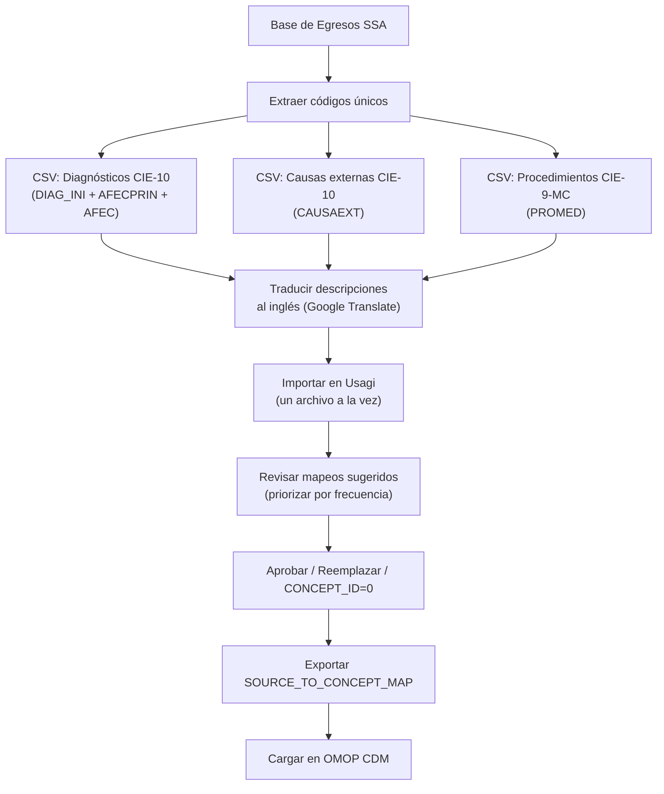

# background

# OMOP specifications - Chapter 4

Data Model: https://ohdsi.github.io/TheBookOfOhdsi/CommonDataModel.html

Data available in DGI BD that fits the model:

## White Rabbit

## Usagi — Pasos para mapear datos de Egresos Hospitalarios SSA (2023–2025)

### Situación de los datos

Los datos provienen de la base de **Egresos Hospitalarios de la Secretaría de Salud** y contienen **4 tablas** (EGRESO, AFECCIONES, PROCEDIMIENTOS, PRODUCTOS). Los códigos médicos que necesitan mapeo a vocabulario estándar (OMOP/SNOMED/RxNorm) a través de Usagi son:

| Campo | Tabla | Sistema de codificación | Dominio OMOP sugerido |
|---|---|---|---|
| `DIAG_INI` | EGRESO | CIE-10 (2021) | Condition |
| `AFECPRIN` | EGRESO | CIE-10 (2021) | Condition |
| `CAUSAEXT` | EGRESO | CIE-10 (2021 — capítulos V–Y) | Observation |
| `AFEC` | AFECCIONES | CIE-10 (2021) | Condition |
| `PROMED` | PROCEDIMIENTOS | CIE-9-MC (2023) | Procedure |

> [!IMPORTANT]
> Usagi requiere que **separes tus códigos por dominio** en archivos independientes. No debes mezclar diagnósticos con procedimientos en un solo archivo.

---

## Pasos concretos

### Paso 0 — Pre-requisitos

1. **Descargar el vocabulario OMOP** desde [Athena](https://athena.ohdsi.org/). Necesitas al menos:
   - SNOMED (para condiciones/diagnósticos)
   - ICD10 / ICD10CM (para poder aprovechar la similitud con CIE-10)
   - ICD9Proc (para procedimientos CIE-9-MC)
2. **Instalar Usagi** desde [GitHub OHDSI/Usagi](https://github.com/OHDSI/Usagi) y construir el índice con los vocabularios descargados (`Help → Rebuild index`).

### Paso 1 — Extraer y preparar los códigos fuente

Necesitas generar **3 archivos CSV/Excel separados**, uno por dominio:

#### Archivo 1: Diagnósticos / Condiciones (CIE-10)
Extraer los códigos únicos de los campos `DIAG_INI`, `AFECPRIN` y `AFEC`, junto con sus descripciones en español (del catálogo `CAT_CIE_10_2021`) y una **traducción al inglés**.

| source_code | source_name_es | source_name_en | frequency |
|---|---|---|---|
| A00 | CÓLERA | Cholera | 15 |
| A000 | CÓLERA DEBIDO A VIBRIO CHOLERAE 01, BIOTIPO CHOLERAE | Cholera due to Vibrio cholerae 01, biotype cholerae | 3 |

> [!TIP]
> - Combina los 3 campos (`DIAG_INI`, `AFECPRIN`, `AFEC`) en una sola lista de códigos únicos para este archivo, ya que todos pertenecen al dominio **Condition**.
> - Incluye la **frecuencia** de cada código (cuántas veces aparece en tu dataset) para priorizar el esfuerzo de revisión.
> - Usa **Google Translate** para traducir las descripciones del español al inglés. Usagi trabaja con similitud textual en inglés.

#### Archivo 2: Causas externas (CIE-10, capítulos V–Y)
Extraer códigos únicos de `CAUSAEXT`:

| source_code | source_name_es | source_name_en | frequency |
|---|---|---|---|
| V010 | PEATÓN LESIONADO POR COLISIÓN CON VEHÍCULO DE PEDAL... | Pedestrian injured in collision with pedal cycle... | 8 |
| W000 | CAÍDA EN EL MISMO NIVEL POR HIELO O NIEVE, VIVIENDA | Fall on same level from ice and snow, dwelling | 2 |

> [!NOTE]
> Las causas externas generalmente mapean al dominio **Observation** en OMOP, no a Condition. Mantenlos en un archivo separado.

#### Archivo 3: Procedimientos (CIE-9-MC)
Extraer códigos únicos de `PROMED` (del catálogo `CATCIE9MC_2023`):

| source_code | source_name_es | source_name_en | procedure_type | frequency |
|---|---|---|---|---|
| 0001 | ULTRASONIDO TERAPÉUTICO DE VASOS DE CABEZA Y CUELLO | Therapeutic ultrasound of head and neck vessels | D | 42 |
| 0031 | CIRUGÍA ASISTIDA POR ORDENADOR CON TAC/TC | Computer assisted surgery with CT/TC | Q | 7 |

> [!TIP]
> El campo `TIPO` (D=Diagnósticos, Q=Quirúrgicos, T=Terapéuticos, F=Mixto) es información adicional útil para el revisor. Inclúyelo como columna "Additional info".

---

### Paso 2 — Importar en Usagi

Para **cada archivo** (repite para los 3):

1. Abre Usagi → `File → Import codes`
2. En **Column mapping** (abajo izquierda):
   - **Source code column**: `source_code`
   - **Source name column**: `source_name_en` (la traducción al inglés)
   - **Source frequency column**: `frequency`
   - **Additional info**: `source_name_es` (para referencia del revisor)
3. En **Filters** (abajo derecha), configura según el archivo:

| Archivo | Filtro de dominio | Vocabulario destino |
|---|---|---|
| Diagnósticos (CIE-10) | **Condition** | SNOMED |
| Causas externas (CIE-10) | **Observation** | SNOMED |
| Procedimientos (CIE-9-MC) | **Procedure** | SNOMED |

4. Click **Import** — espera a que termine el algoritmo de similitud.

---

### Paso 3 — Revisar y aprobar mapeos

> [!IMPORTANT]
> Idealmente, una persona con experiencia en terminología médica y los sistemas de codificación (CIE-10, CIE-9-MC) debe participar en esta revisión.

1. **Ordena por frecuencia** (`Frequency` descendente) para priorizar los códigos más usados.
2. **Revisa código por código**:
   - Si el mapeo sugerido es correcto → click **Approve** ✅
   - Si no es correcto → usa el buscador para encontrar un mejor concepto → **Replace concept** → **Approve**
   - Si no hay concepto adecuado → dejar como `CONCEPT_ID = 0` (está bien para códigos raros)
3. **Usa la información del concepto** (`ALT + C`) para verificar la "vida social" del concepto: sus padres, hijos y relaciones jerárquicas.
4. **Agrega comentarios** a los mapeos difíciles para documentar tus decisiones.

#### Consideraciones especiales para estos datos:

- **CIE-10 mexicana (2021)**: Es una adaptación de ICD-10, muy cercana pero con algunas diferencias. Usagi debería mapear bien la mayoría de códigos por similitud textual con ICD10/ICD10CM.
- **CIE-9-MC (2023)**: Es la versión mexicana de ICD-9-CM Procedures. Usagi buscará equivalentes en el vocabulario de procedimientos SNOMED/CPT4.
- **Códigos con score > 0.7**: Probablemente correctos, pero siempre verificar.
- **Códigos con score < 0.5**: Requieren revisión manual cuidadosa.

---

### Paso 4 — Exportar el mapeo

1. `File → Export source_to_concept_map`
2. Define un **SOURCE_VOCABULARY_ID** para cada archivo:
   - `SSA_CIE10_DX` para diagnósticos
   - `SSA_CIE10_EXT` para causas externas
   - `SSA_CIE9MC_PX` para procedimientos
3. Guarda el CSV resultante.
4. Solo los mapeos con estatus **"Approved"** se exportarán.

---

### Paso 5 — Cargar en OMOP CDM

1. Agrega los CSV exportados a la tabla `SOURCE_TO_CONCEPT_MAP` del vocabulario.
2. Agrega una fila por cada `SOURCE_VOCABULARY_ID` nuevo en la tabla `VOCABULARY`.

---

## Campos que NO necesitan Usagi

Los siguientes campos del dataset ya son **códigos categóricos simples** con catálogos cerrados y no requieren mapeo a través de Usagi. Se mapean directamente en el ETL:

| Campo | Descripción | Mapeo directo |
|---|---|---|
| `SEXO` | Sexo del paciente | → `concept_id` de OMOP Gender |
| `CVEEDAD` | Tipo de unidad de edad | Lógica ETL directa |
| `EDAD` | Edad numérica | Campo numérico en OMOP |
| `MOTEGRE` | Motivo de egreso | Mapeo manual (5-8 valores) |
| `DERHAB` | Derechohabiencia | Mapeo manual |
| `TIPSERV` | Tipo de servicio | Mapeo manual |
| `ENTIDAD/MUNIC/LOC` | Geografía | → `location` table |
| `INFEC` | Infección intrahospitalaria | Sí/No → flag |
| Campos obstétricos | `GESTAS`, `PARTOS`, `TIPNACI`, etc. | Mapeo manual (catálogos pequeños) |

> [!NOTE]
> Estos catálogos pequeños (< 15 valores) se mapean manualmente dentro del código ETL, no con Usagi.

---

## Resumen visual del flujo

